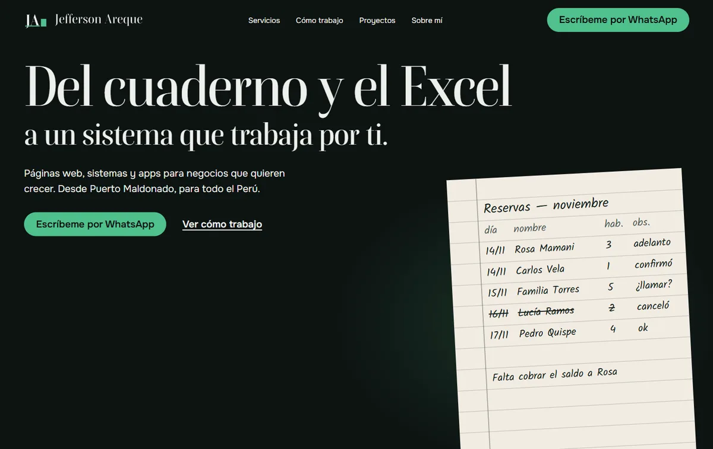

# Landing de servicios — Jefferson Areque

Página de una sola pantalla con scroll para ofrecer mis servicios de desarrollo (páginas web, sistemas
y apps) a negocios de Madre de Dios y del resto del Perú. También la grabo haciendo scroll para usarla
como video en TikTok y LinkedIn.



## Tecnologías

- React + Vite
- Tailwind CSS
- [motion](https://motion.dev) para las animaciones al hacer scroll

## Cómo correrlo

Necesitas Node.js 20.19 o superior.

```bash
git clone https://github.com/JeffersonAreque/landing-servicios.git
cd landing-servicios
npm install
npm run dev        # http://localhost:5173
```

Para generar la versión de producción:

```bash
npm run build      # queda en dist/
npm run preview    # la sirve para revisarla
```

El build falla a propósito si queda alguna foto o captura de relleno (ver `vite.config.js`).

## Organización

```
src/components/   secciones de la página (Hero, Servicios, Proyectos, Contacto...)
src/assets/       capturas de proyectos y fotos, ya optimizadas en WebP
src/data/         datos de ejemplo del hero y créditos de fotos (credits.json)
diseno/           logo y scripts que lo generan
BRIEF.md          qué dice la página
DESIGN.md         cómo se ve: colores, tipografía, espaciado y movimiento
```

## Créditos

- Foto del río Madre de Dios: Alet123,
  [Wikimedia Commons](https://commons.wikimedia.org/wiki/File:Puerto_Maldonado_Madre_de_Dios_river.jpg),
  [CC BY-SA 4.0](https://creativecommons.org/licenses/by-sa/4.0/). Reducida de tamaño y convertida a WebP.
- Las capturas de Proyectos son de mis sistemas funcionando con datos de prueba.

## Contacto

Jefferson Areque · Puerto Maldonado, Perú · [GitHub](https://github.com/JeffersonAreque) ·
[Portafolio](https://jefferson-areque.vercel.app)
